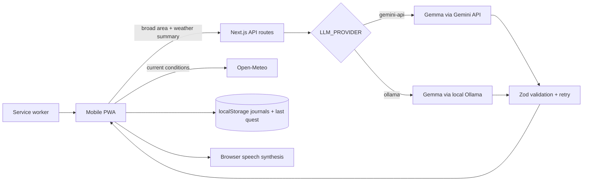

# Pagdandi

> Take the path less scrolled.

Pagdandi (पगडंडी, “footpath”) is a mobile-first, audio-led walk companion. Pick 15, 30, or 60 minutes and a mood; open-weight Gemma creates a handful of weather-aware observation missions, reads them aloud, then helps turn the walk into a private field note. The key outcome is intentionally not engagement: Pagdandi shows **time outside vs. time the screen was active**.

Built October 5–11, 2026 for the [DEV Hacktoberfest Open-Source AI Challenge: Week 1 — Touch Grass](https://dev.to/challenges/hacktoberfest-week1-2026-10-05).

## Screenshots

> Add final home, walk-mode, and field-journal screenshots before submission.

| Plan a walk | Pocket-first walk mode | A private field note |
| --- | --- | --- |
| `docs/screenshots/home.png` | `docs/screenshots/walk.png` | `docs/screenshots/journal.png` |

## Why open matters

Gemma is not decoration here: it creates the quests, cautious photo guesses, and final field notes. A small provider interface makes those same open weights available in two ways:

- `gemini-api` serves Gemma through Google’s Gemini API for the public Render demo.
- `ollama` runs Gemma locally, so prompts and images stay on the user’s computer.

No closed `gemini-*` model is used. Prompts live in versioned files and all instructions are kept in the user turn for portability across hosted Gemma 4 and local Ollama model variants. Structured responses are extracted from plain text, validated with Zod, and retried up to twice after an invalid response.

## Architecture



The browser never receives `GEMINI_API_KEY`. Exact coordinates are used only in the browser for Open-Meteo and are rounded in that request; the model gets a broad area label plus a weather summary. Journals stay in `localStorage`. Photos are resized to at most 1024 px in the browser, processed in memory, and never stored.

## Run with Gemma via the Gemini API

```bash
npm install
cp .env.example .env.local
```

Add `GEMINI_API_KEY` to `.env.local`. Because model availability can differ by account and change over time, discover what the key can use instead of copying a stale model name:

```bash
curl "https://generativelanguage.googleapis.com/v1beta/models?pageSize=1000&key=$GEMINI_API_KEY" \
  | jq -r '.models[] | select(.name | ascii_downcase | contains("gemma")) | select(.supportedGenerationMethods | index("generateContent")) | .name'
```

Set the chosen name without the `models/` prefix:

```dotenv
LLM_PROVIDER=gemini-api
GEMMA_MODEL=your-available-multimodal-gemma-model
```

Then run:

```bash
npm run dev
```

The server-only `GET /api/models` endpoint exposes the same filtered discovery when a key is configured; it never returns the key.

## Run fully local with Ollama

Install [Ollama](https://ollama.com), then use a multimodal Gemma tag available for your Ollama installation. Verify the tag on the Ollama model library rather than assuming the example is current.

```bash
ollama pull gemma3:12b
ollama serve
```

```dotenv
LLM_PROVIDER=ollama
OLLAMA_BASE_URL=http://localhost:11434
OLLAMA_MODEL=gemma3:12b
```

```bash
npm run dev
```

In local mode the Next.js server must be able to reach Ollama. The service worker preserves the app shell while the last generated quest is stored locally for weak-signal reuse.

## Environment variables

| Variable | Required | Default | Purpose |
| --- | --- | --- | --- |
| `LLM_PROVIDER` | No | `gemini-api` | `gemini-api` or `ollama` |
| `GEMINI_API_KEY` | Gemini mode | — | Server-only Google AI Studio key |
| `GEMMA_MODEL` | Gemini mode | — | Available Gemma model discovered for the key |
| `OLLAMA_BASE_URL` | Ollama mode | `http://localhost:11434` | Local Ollama server |
| `OLLAMA_MODEL` | Ollama mode | — | Installed multimodal Gemma tag |

## Deploy to Render

1. Push this repository to a Git host.
2. In Render, create a Blueprint and select the repo. `render.yaml` creates the Node Web Service.
3. In the Render dashboard, set `GEMINI_API_KEY` and `GEMMA_MODEL` as secret environment variables. Do not put the key in `render.yaml`.
4. Deploy. The health check is `/api/health`.
5. Open the HTTPS URL once and install the PWA from the browser menu.

The free Render plan can cold-start. The UI treats generation as a short transition and provides a static sample quest if the model is not configured.

## Quality checks

```bash
npm run lint
npm test
npm run build
```

Tests cover JSON extraction/validation, provider switching, and screen-time calculations.

## Safety and privacy

- The model never receives exact coordinates.
- No authentication, analytics, database, or social feed.
- Journal entries remain in browser `localStorage` and disappear if site data is cleared.
- Photos are resized client-side and are not logged or saved by the app.
- Photo identification always includes uncertainty and is never edibility or handling advice.
- Missions prohibit private property, touching/eating unknown nature, and unsafe routes.
- Simple in-memory rate limits protect generation endpoints. For multi-instance production, replace this with a shared limiter.

## Limitations

- Browser speech synthesis voice quality differs by device; speech may stop when some phones lock the page.
- `localStorage` is device- and browser-specific, unencrypted, and has no sync or recovery.
- Weather describes current conditions, not street-level hazards or air quality.
- AI photo guesses can be wrong and must not be used for safety, edibility, or medical decisions.
- The service worker caches the app shell, but generating a new quest still requires a reachable provider.

## Credits

- [Gemma](https://ai.google.dev/gemma) by Google DeepMind — open-weight intelligence.
- [Open-Meteo](https://open-meteo.com/) — free geocoding and weather data.
- [Next.js](https://nextjs.org/), [React](https://react.dev/), [Tailwind CSS](https://tailwindcss.com/), and [Zod](https://zod.dev/).
- Product concept, interface, prompts, and implementation created for this challenge. No non-trivial third-party source code was copied.

## License

MIT — see [LICENSE](LICENSE).
